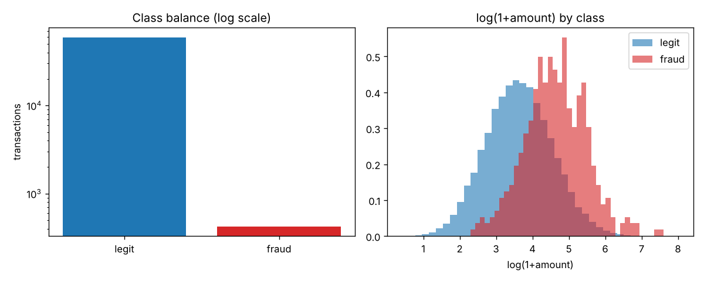
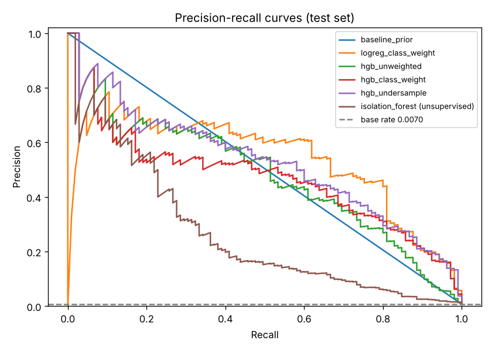
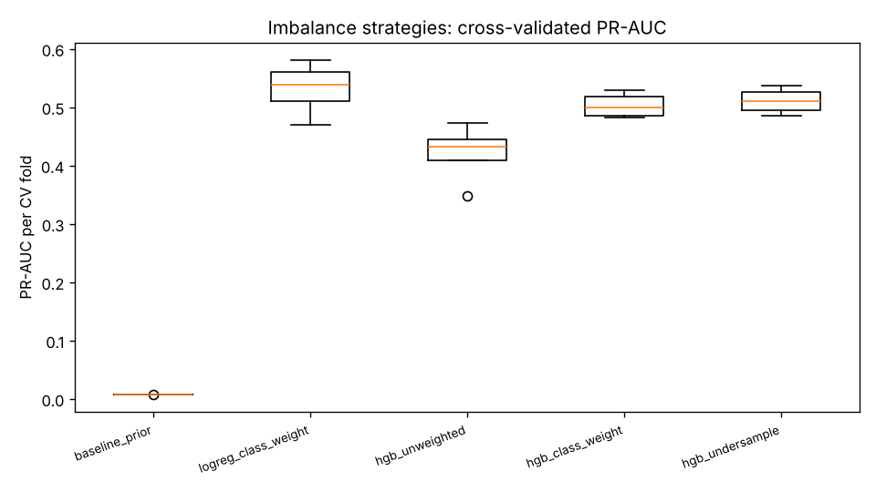
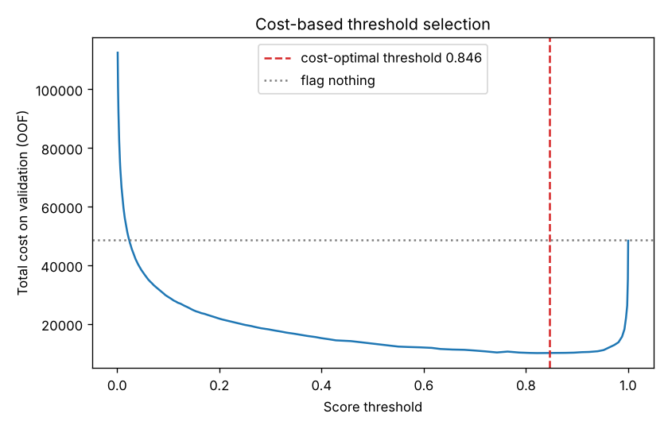
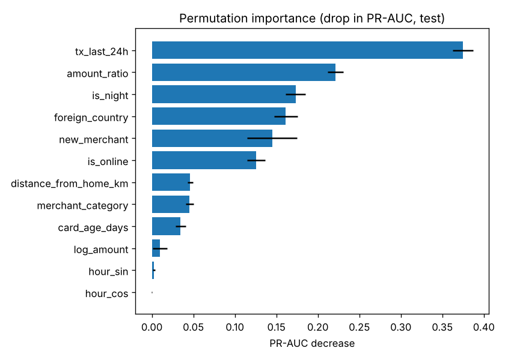

# Credit Card Fraud Detection (imbalanced, cost-aware)

Fraud scoring on highly imbalanced synthetic transactions: imbalance strategies compared by PR-AUC, an unsupervised IsolationForest comparison, and a threshold chosen to minimise a monetary cost.

## Problem statement
Fraud is rare (well under 1% of transactions), so accuracy and ROC-AUC are misleading. The goal is to rank transactions by fraud risk, compare class weighting with undersampling, check how an unsupervised anomaly detector fares without labels, and pick an alert threshold from a business cost model (missed fraud costs its amount; each flagged transaction costs a 5.00 review fee) instead of the default 0.5.

## Highlights (from `reports/metrics.json`)
- Data: 60,000 synthetic transactions, 422 frauds (0.703%); test set 15,000 rows with 105 frauds.
- 4-fold CV PR-AUC: `logreg_class_weight` 0.532 (+/- 0.041, best), `hgb_undersample` 0.511, `hgb_class_weight` 0.503, `hgb_unweighted` 0.421, prior baseline 0.0070.
- Test PR-AUC: logreg class-weight 0.537 (ROC-AUC 0.992); IsolationForest (no labels) 0.265 (ROC-AUC 0.935); base rate 0.0070.
- Cost-based threshold (0.846, chosen on out-of-fold train scores): test cost 3,017.72 vs. 14,272.67 for flagging nothing (78.9% saving) and 4,198.68 at threshold 0.5.
- These results hold on data built with known fraud patterns; they do not predict real-world performance.

## Data
Entirely **synthetic**, generated by a seeded generator (`src/fraud/data.py`); it is not real card data. Fraud probability follows a latent logistic model with typical fraud patterns: night-time hours, amount high relative to the card's own 30-day average, new merchant category for the card, rapid-velocity bursts (extra transactions in 24h), foreign and card-not-present (online) use, distance from home, card age and merchant category, plus Gaussian noise on the latent score so classes overlap. The intercept is calibrated to a ~0.7% base rate; 3% of `distance_from_home_km` values are missing. `data/sample_transactions.csv` is a small committed sample (all frauds plus 6,000 legit rows); the full set is regenerated by the pipeline.

## Project structure
```
src/fraud/    config, data, features, train, evaluate, plots, predict
scripts/run_pipeline.py   data -> CV -> test evaluation -> reports + model
tests/        unittest suite
reports/      metrics.json, figures/
data/         sample_transactions.csv
models/       fraud_model.joblib (generated, git-ignored)
```

## Quickstart
```
pip install -r requirements.txt
python scripts/run_pipeline.py          # about 1.5 minutes on CPU
python -m unittest discover -s tests -v
python -m fraud.predict in.csv out.csv  # run with PYTHONPATH=src
```
`make install | data | train | test | run` wrap the same commands.

## Methodology
- Stratified 75/25 train/test split; the test set is touched once.
- Features: log amount, amount / 30-day average, cyclic hour, night flag, online, distance, 24h count, card age, foreign flag, day of week, one-hot merchant category. Median imputation and scaling live inside the sklearn pipeline (fit on training folds only).
- Strategies (4-fold stratified CV on train, PR-AUC): prior baseline, logistic regression with balanced class weights, HistGradientBoosting unweighted / class-weighted / with random undersampling (10 legit : 1 fraud, applied to training folds only).
- IsolationForest is fit without labels and evaluated at the same alert budget as the cost-optimal supervised model.
- Threshold: minimise total cost over a quantile grid on out-of-fold train scores, then apply once to test.
- Permutation importance (PR-AUC drop) on test for the best model.

## Results
| Model | CV PR-AUC | Test PR-AUC |
|---|---|---|
| Prior baseline | 0.0070 | 0.0070 |
| Logistic regression, class weights | 0.532 | 0.537 |
| HGB unweighted | 0.421 | 0.480 |
| HGB class weights | 0.503 | 0.470 |
| HGB undersampling | 0.511 | 0.526 |
| IsolationForest (unsupervised) | n/a | 0.265 |

At the cost-optimal threshold the best model flags 414 test transactions: precision 0.225, recall 0.886, F1 0.358. At threshold 0.5 it flags 820 (precision 0.126, recall 0.981). Top features: `tx_last_24h`, `amount_ratio`, `is_night`, `foreign_country`, `new_merchant`.







## Limitations and future work
- Synthetic data: the generator encodes the very patterns the models then learn, and the logistic structure favours logistic regression. Real fraud is adversarial, drifting and messier.
- 105 test frauds: differences of a few points in PR-AUC between strategies are within noise (CV std 0.02-0.05).
- The cost model (5.00 review fee, loss equals amount) is an assumption; the optimal threshold depends on it.
- Not tuned: gradient boosting hyperparameters were fixed. Random split, not time-based.
- Future: time-based split, calibration, cost-sensitive learning, per-card sequence features.

## Using a real dataset
The Kaggle "Credit Card Fraud Detection" dataset (ULB, `creditcard.csv`: `Time`, `V1`-`V28`, `Amount`, `Class`) is a suitable swap. Map `Class` to `is_fraud` and `Amount` to `amount`, replace `NUMERIC` in `src/fraud/config.py` with `V1`-`V28`, `Amount` (drop the synthetic-only features and `CATEGORICAL`), adapt `add_features`, and pass the CSV through `load_data(path)`. Use a time-based split on `Time`.

## License
MIT, see `LICENSE`.
